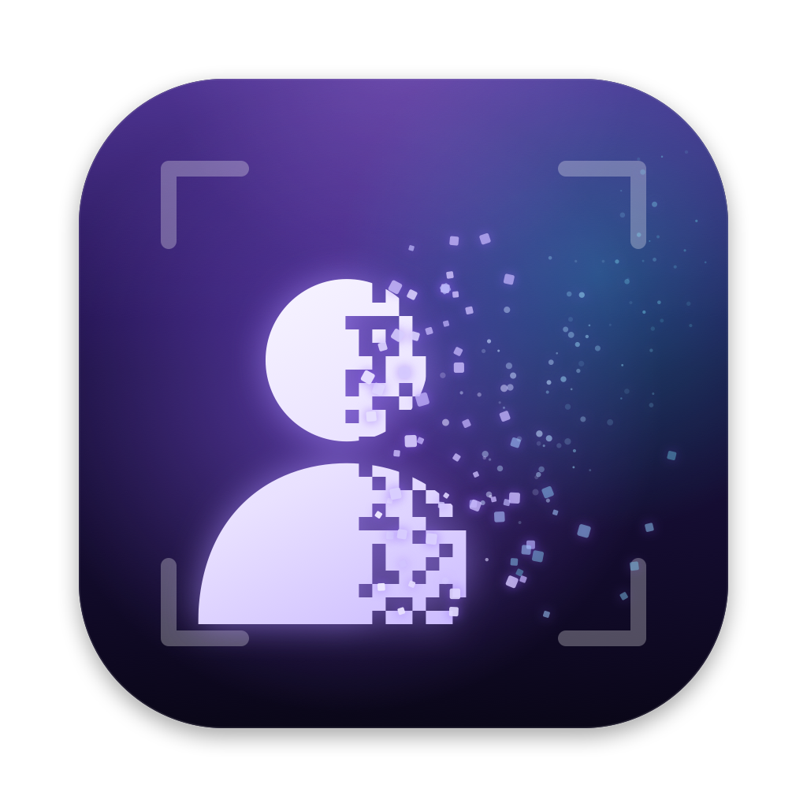

# Ghosted



macOS menu-bar app that adds a **Ghosted Camera** virtual camera. Pick it in any call app (Zoom, Meet, Teams, Telegram, FaceTime…) and vanish into dust with a shortcut (⌃⌥V), a finger snap or a “V” sign.

The product is named **Ghosted**; the code, targets, module and bundle IDs (`com.vanishcam.*`) keep the original working name *Vanish* so the installed camera extension and App Group keep working.

Design: `docs/superpowers/specs/2026-11-16-vanish-design.md` · Plan: `docs/superpowers/plans/2026-11-16-vanish.md`

## Install

```bash
brew tap Igor-bite/ghosted https://github.com/Igor-bite/ghosted
brew trust igor-bite/ghosted   # newer Homebrew asks to trust third-party taps
brew install --cask ghosted
```

Or download `Ghosted-<version>.dmg` from [Releases](https://github.com/Igor-bite/ghosted/releases), open it and drag `Ghosted.app` to `Applications`. The app is signed with Developer ID and notarized. On first launch approve the camera extension (macOS 15+: System Settings → General → Login Items & Extensions → Camera Extensions; macOS 13–14: Privacy & Security → Allow).

## Layout

| Path | What |
|---|---|
| `App/` | Ghosted.app: capture → Vision segmentation → Core Image / Metal dust → CMIO sink |
| `CameraExtension/` | CoreMediaIO Camera Extension: relays sink frames to the source stream; bilingual stub when the app is not running |
| `Shared/` | Constants shared by both targets |
| `Packages/VanishCore/` | Pure logic (state machine, gestures, room-plate stats) with unit tests |
| `Tools/make-icons.swift` | Generates the app icon, menu-bar template icons and accent color into `App/Assets.xcassets` (`swift Tools/make-icons.swift`) |
| `project.yml` | XcodeGen project definition (the `.xcodeproj` is generated, not committed) |

## Build

```bash
brew install xcodegen
xcodegen generate
swift test --package-path Packages/VanishCore
xcodebuild -project Vanish.xcodeproj -scheme Vanish -configuration Debug -derivedDataPath build/DD -allowProvisioningUpdates build
```

Signing: team `4D7YJ8BY8H`, automatic signing. A Debug build needs this Mac registered in the developer account. The system extension activates only when the app runs from `/Applications` and the user approves it (macOS 15+: General → Login Items & Extensions → Camera Extensions; macOS 13–14: Privacy & Security → Allow).

## Release

1. Bump `MARKETING_VERSION` / `CURRENT_PROJECT_VERSION` in `project.yml`, `xcodegen generate`.
2. Archive: `xcodebuild -project Vanish.xcodeproj -scheme Vanish -configuration Release -archivePath build/release/Ghosted.xcarchive -allowProvisioningUpdates archive`.
3. Export with Developer ID and upload to notarization (`Tools/ExportOptions.plist`): `xcodebuild -exportArchive -archivePath build/release/Ghosted.xcarchive -exportOptionsPlist Tools/ExportOptions.plist -exportPath build/release/export -allowProvisioningUpdates`.
4. Fetch the stapled app: `xcodebuild -exportNotarizedApp -archivePath build/release/Ghosted.xcarchive -exportPath build/release/notarized`.
5. Zip for Homebrew: `ditto -c -k --sequesterRsrc --keepParent build/release/notarized/Ghosted.app Ghosted-<version>.zip`.
6. DMG: copy the notarized app and an `Applications` symlink into a folder, then
   `hdiutil create -volname "Ghosted <version>" -srcfolder <folder> -fs HFS+ -format UDZO -imagekey zlib-level=9 Ghosted-<version>.dmg`,
   `codesign --sign "Developer ID Application: Igor Klyuzhev (4D7YJ8BY8H)" --timestamp Ghosted-<version>.dmg`,
   `xcrun notarytool submit Ghosted-<version>.dmg --keychain-profile ghosted-notary --wait`, `xcrun stapler staple Ghosted-<version>.dmg`.
   One-time setup: `xcrun notarytool store-credentials ghosted-notary --apple-id <Apple ID> --team-id 4D7YJ8BY8H` (app-specific password).
7. Publish both: `gh release create v<version> Ghosted-<version>.zip Ghosted-<version>.dmg`.
8. Update `version` and `sha256` (`shasum -a 256`) in `Casks/ghosted.rb`.
